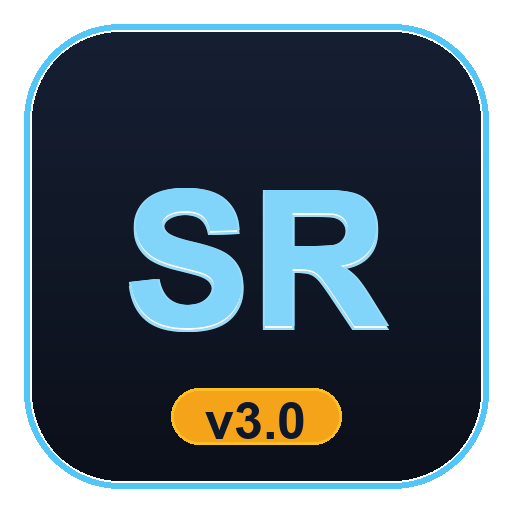

# SkinRate Calculator

<p align="center">
  
</p>

A small Windows calculator for CS2 skin and Steam wallet deals in Bangladeshi Taka: dollar-to-taka rates, bKash/Nagad cashout fees, the 15% Steam Market tax, and the reverse (how many dollars a taka budget buys).

## Features

- **Rate calculator:** converts a dollar amount at your rate (default 85 ৳/$). Skin transfers and Steam wallet use the same rate.
- **Cashout fees:** shows the cost for bKash Agent (+1.85%), bKash Priyo (+1.49%) and Nagad App (+1.25%).
- **Steam Market tax:** amount with 15% added, with 15% removed, and the base amount.
- **Reverse calculator:** enter a taka budget and see how many dollars of skins or wallet it gets you.
- **Rate cheat sheet:** a table from $1 to $1,000 that you can copy in one click.
- **Trade slip:** a ready-to-paste quote for Facebook groups, Discord or Messenger.
- Remembers your rate, fee and theme, and keeps a calculation history.
- Android version in `SkinRateCalculator Mobile/`.

## Keyboard shortcuts

| Shortcut | Action |
| :--- | :--- |
| `Enter` | Calculate |
| `Esc` | Clear fields |
| `Ctrl + C` | Trade slip |
| `Ctrl + T` | Dark / light theme |
| `Ctrl + H` | History |
| `Ctrl + S` | Settings |
| `Ctrl + 1` / `2` / `3` | Rate calculator / Reverse calculator / Cheat sheet |

## Run

Double-click `SkinRate Calculator.exe`, or download it from [Releases](../../releases).

From source:

```bash
pip install -r requirements.txt
python main.py
```
